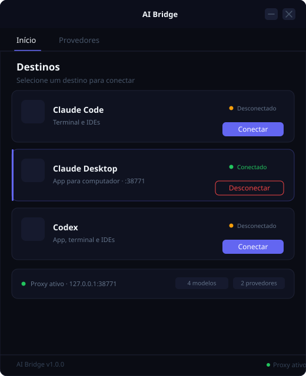
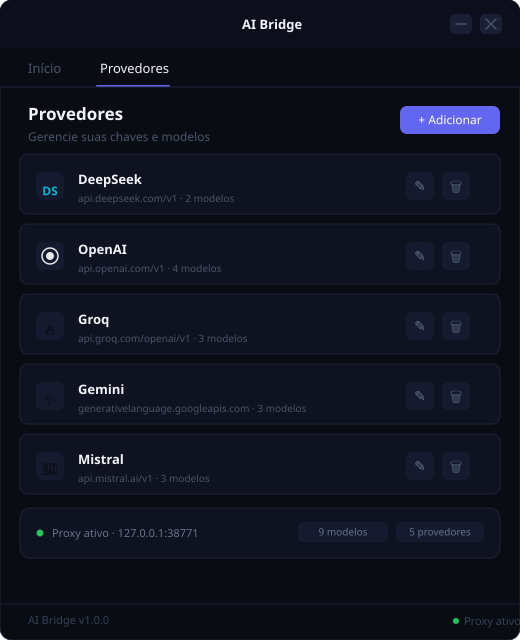
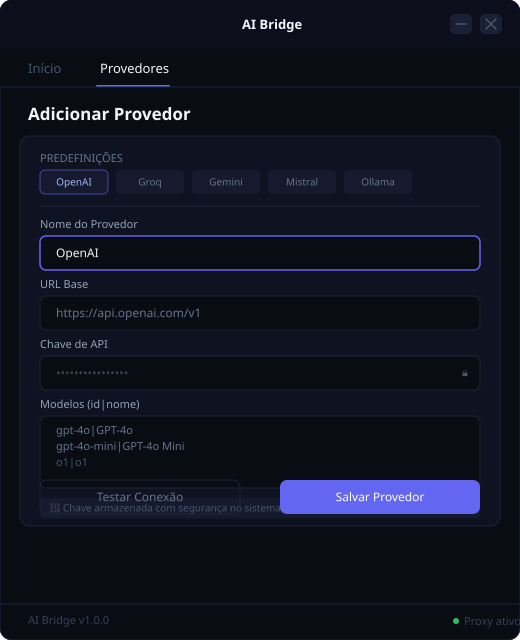

# AI Bridge + Codex Web GPT

> Proxy local que conecta Claude Code, Claude Desktop e Codex a qualquer modelo OpenAI-compatible — DeepSeek, GPT-4o, Gemini, Groq, Mistral e mais.

<div align="center">



</div>

---

## O que é

**AI Bridge** é um aplicativo de desktop que roda um proxy HTTP local traduzindo o protocolo Anthropic Messages API (usado por Claude Code, Claude Desktop e Codex) para o formato OpenAI-compatible. Com ele você usa qualquer provedor de LLM no lugar dos modelos Claude — sem modificar as ferramentas.

### Como funciona

```
Claude Code / Claude Desktop / Codex
          │  (Anthropic API)
          ▼
    AI Bridge Proxy
     127.0.0.1:38771
          │  (OpenAI API)
          ▼
  DeepSeek / GPT-4o / Gemini / Groq / …
```

---

## Download

| Plataforma | Link |
|------------|------|
| **Windows** (.exe) | [⬇ AI-Bridge-Windows.exe](https://github.com/LMPrado-DZ23/ai-bridge-chatgpt-web/releases/latest/download/AI-Bridge-Windows.exe) |
| **macOS** (binário) | [⬇ AI-Bridge-macOS](https://github.com/LMPrado-DZ23/ai-bridge-chatgpt-web/releases/latest/download/AI-Bridge-macOS) |
| **Linux** (binário) | [⬇ AI-Bridge-Linux](https://github.com/LMPrado-DZ23/ai-bridge-chatgpt-web/releases/latest/download/AI-Bridge-Linux) |

Ou veja todas as versões na [página de releases](https://github.com/LMPrado-DZ23/ai-bridge-chatgpt-web/releases).

---

## Interface

<table>
<tr>
<td align="center" width="33%">

**Destinos**


Conecte Claude Code, Claude Desktop ou Codex ao proxy

</td>
<td align="center" width="33%">

**Provedores**



Gerencie múltiplos provedores e seus modelos

</td>
<td align="center" width="33%">

**Adicionar Provedor**



Cadastre qualquer API OpenAI-compatible com presets

</td>
</tr>
</table>

---

## Provedores suportados

| Provedor | Endpoint padrão | Modelos incluídos |
|----------|-----------------|-------------------|
| **DeepSeek** | `api.deepseek.com/v1` | DeepSeek Chat, Reasoner |
| **OpenAI** | `api.openai.com/v1` | GPT-4o, GPT-4o Mini, o1, o3 Mini |
| **Groq** | `api.groq.com/openai/v1` | Llama 3.3 70B, Llama 3.1 8B, Gemma 2 9B |
| **Gemini** | `generativelanguage.googleapis.com/v1beta/openai` | Gemini 2.0 Flash, 2.5 Pro, 2.5 Flash |
| **Mistral** | `api.mistral.ai/v1` | Mistral Large, Small, Codestral |
| **OpenRouter** | `openrouter.ai/api/v1` | GPT-4o, Claude Opus 4.5 (via OpenRouter) |
| **Together** | `api.together.xyz/v1` | Llama 3.3 70B Turbo, Qwen 2.5 Coder 32B |
| **Ollama** | `localhost:11434/v1` | Llama 3.2, Qwen 2.5 Coder, DeepSeek R1 |
| **Claude Gateway** | `claude-ss.ia.br/v1` | Claude Sonnet 5, Opus 5.5, Fable 5.1, Haiku 4.5 |

Qualquer provedor com API OpenAI-compatible pode ser adicionado manualmente.

---

## Destinos suportados

| Destino | Protocolo | Como conecta |
|---------|-----------|--------------|
| **Claude Code** | Anthropic | Configura `ANTHROPIC_BASE_URL` + `ANTHROPIC_API_KEY` |
| **Claude Desktop** | Gateway de inferência 3P | Mantém um perfil reversível em `%LOCALAPPDATA%\\Claude-3p\\configLibrary`; troca de modo em um clique com reinício controlado e validação da janela |
| **Codex Desktop** | OpenAI Responses API | Configura um provedor local AI Bridge e catálogo JSON absoluto; alterna entre AI Bridge e Invision/provedor original em um clique |

---

### Aplicativo unificado: AI Bridge + Codex Web GPT

O repositório reúne o **AI Bridge** e o **Codex Web GPT** em um único aplicativo desktop. A janela Electron hospeda os dois workspaces: o Codex Web GPT mantém a experiência de conversa, ferramentas e MCP; o AI Bridge fornece a gestão de provedores, modelos e destinos Claude/Codex. A interface do AI Bridge é carregada dentro da mesma janela, e o serviço Python roda como processo filho gerenciado pelo launcher.

- A navegação lateral da janela principal alterna entre **Codex Web GPT** e **AI Bridge**, sem abrir um segundo aplicativo.
- A sessão autenticada do Codex Web GPT continua sob controle do launcher e não é copiada, apagada, substituída nem migrada pelo workspace AI Bridge.
- O serviço do AI Bridge usa RPC local com token aleatório por execução, allowlist explícita de métodos e validação da origem Electron; o token administrativo do Bridge não é enviado ao renderer.
- O launcher integrado está em `integrations/codex-chatgpt-web/launcher/`; no Windows, o pacote validado é NSIS per-user. O smoke test instala apenas em uma pasta temporária, valida o runtime empacotado e verifica a restauração do Registro e dos atalhos.
- O proxy local do AI Bridge permanece em `http://127.0.0.1:38771`; o catálogo `/v1/codex-models` expõe apenas metadados dos modelos, nunca chaves de API.

A versão integrada do Codex Web GPT conserva a licença e a atribuição upstream em `integrations/codex-chatgpt-web/`. No Windows, o instalador unificado inclui o serviço do AI Bridge e sua UI.

---

## Segurança

- **Chaves de API nunca gravadas em disco**: armazenadas no keyring do sistema operacional (Credential Manager no Windows, Keychain no macOS, Secret Service no Linux)
- **Proxy exclusivamente local**: vinculado a `127.0.0.1` — nunca exposto à rede
- **Frontend não recebe a chave**: o backend retorna apenas um booleano `has_key` para o UI; a chave real nunca trafega para o lado web
- **Arquivos de configuração limpos**: `~/.ai-bridge/config.json` contém apenas metadados dos provedores, sem segredos

---

## Instalação a partir do código-fonte

```bash
# Requisitos: Python 3.10+
git clone https://github.com/LMPrado-DZ23/ai-bridge-chatgpt-web.git
cd ai-bridge-chatgpt-web

python -m pip install -r requirements.txt
python entry.py
```

### Dependências principais

```
flask          # Proxy HTTP
httpx          # Chamadas aos provedores
pywebview      # Janela desktop (Chromium embutido)
keyring        # Armazenamento seguro de chaves
```

---

## Testes

```bash
pip install pytest
python -m pytest tests/ -v
```

A suíte contém **143 testes automatizados** (última execução local validada em 29/10/2026) cobrindo:

- Tradução Anthropic Messages ↔ OpenAI Chat Completions e Responses API
- Streaming SSE e tool/function calling
- Validação de provedores, erros de autenticação e timeout sem expor chaves
- Catálogos multi-provedor para os seletores do Codex Desktop e Claude Desktop
- Conexão/desconexão reversível, preservação do provedor Invision e configuração TOML
- Restauração segura de configurações e detecção de instalação dos aplicativos

Validação local em 29/10/2026: `143 passed`; `compileall` e `git diff --check` concluídos sem erros. O build de produção do launcher, os 80 testes focados do Electron/runtime e o smoke test do instalador Windows isolado passaram. A suíte completa do Codex Web GPT está sendo executada.

---

## Estrutura do projeto

```
ai_bridge/
├── __init__.py
├── bridge.py       # Bridge pywebview — métodos JS↔Python
├── claude_code.py  # Integração Claude Code (env vars)
├── claude_desktop.py # Integração Claude Desktop (config JSON)
├── codex.py        # Integração Codex
├── config.py       # Configuração + keyring
├── proxy.py        # Servidor Flask (proxy HTTP)
└── translate.py    # Tradução Anthropic ↔ OpenAI

ui/
├── index.html      # Interface principal (Tailwind CSS)
└── assets/

tests/
└── test_translate.py  # 24 testes unitários

docs/
├── screen-home.svg
├── screen-providers.svg
└── screen-add.svg
```

---

## Licença

MIT

---

<div align="center">
<sub>Feito com Python + Flask + pywebview · Interface inspirada em Vercel / Linear / Stripe</sub>
</div>
